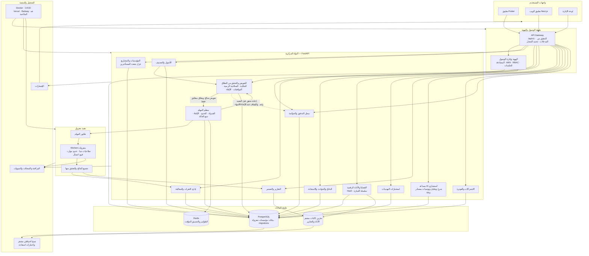
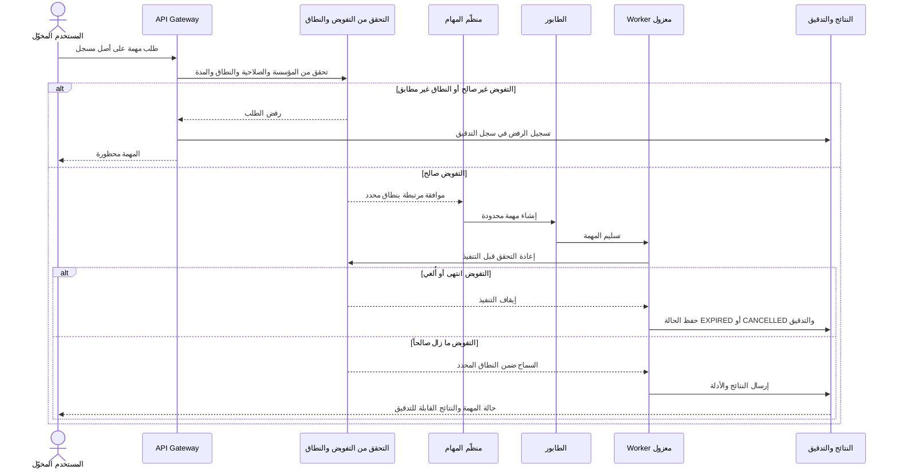

# CyberX Pro — المخطط الهندسي والتنفيذي

> **الإصدار:** 1.0  
> **المبدأ الحاكم:** لا يُنفّذ أي تقييم أمني إلا على أصل ضمن نطاق تفويض موثّق وساري. يظل الذكاء الاصطناعي استشارياً، ولا يقرر التفويض أو يشغّل الفحوص.

## المخطط المعماري

## دورة المهمة الأمنية المصرح بها

## مبادئ التنفيذ

- **حاجز تفويض إلزامي:** يُفرض في API ومنظّم المهام والعامل قبل التنفيذ؛ لا تتجاوزه الواجهة أو خدمات AI.
- **عزل المؤسسات:** تُربط البيانات الحساسة بهوية المؤسسة وتُفرض ضوابط العزل في قاعدة البيانات وطبقة الخدمات.
- **تنفيذ محدود وآمن:** Workers معزولة، بصلاحيات دنيا وحدود للموارد والوقت والاتصالات، مع دعم الإلغاء.
- **أدلة موثوقة:** تُحفظ الأصول الأصلية دون تعديل، وتُسجل قيم التجزئة وسلسلة الحيازة وكل عملية وصول.
- **AI استشاري:** يحلل البيانات المصرح بها ويشرح الثقة والمصادر؛ لا يمنح تفويضاً ولا يرسل أوامر للأهداف ولا يغيّر الأدلة.
- **قابلية التدقيق والاستعادة:** تسجل العمليات الحساسة، وتُراقب الخدمات، وتُشفّر النسخ الاحتياطية وتُختبر استعادتها.

## المراحل التنفيذية

1. **Foundation:** هيكل المستودع، API، الصحة والجاهزية، نطاق التفويض، الاختبارات، Docker وCI.
2. **SaaS Core:** الهوية وMFA والمؤسسات وRBAC وعزل المستأجرين وسجلات التدقيق.
3. **Security Assessment:** الأصول والتفويض والمهام والعمال والنتائج والثغرات والتقارير.
4. **Defense & Intelligence:** الحوادث والدفاع والاستخبارات والأدلة الرقمية ومحاكاة آمنة.
5. **AI Intelligence:** تحليل وتلخيص وتوصيات استشارية مع درجات ثقة ومصادر.
6. **Applications:** تطبيق Flutter والويب ولوحة الإدارة والتصميم متعدد اللغات.
7. **Business Platform:** الخطط والاشتراكات والفوترة وحدود الاستخدام.
8. **Production:** النشر والمراقبة والنسخ الاحتياطي والاستعادة واختبارات الأمان والأداء.
